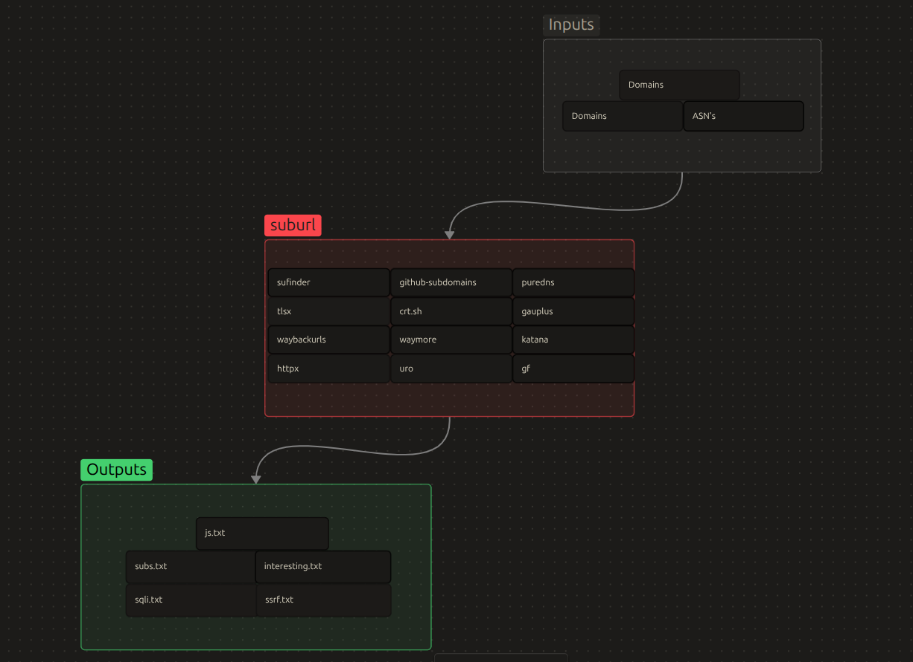

# suburl

<p align="center">
  
</p>

A lightweight bash automation script that chains together popular subdomain enumeration and URL discovery tools into a single recon pipeline for a target domain.

It runs passive/active subdomain discovery, historical & live URL collection, then filters the results for sensitive files, JS endpoints, and potential SSRF/SQLi injection points.

## Features

- **Subdomain enumeration** via `subfinder`, `github-subdomains`, `crt.sh`, `puredns` (optional bruteforce), and `tlsx` (certificate SANs)
- **URL discovery** via `gauplus`, `waybackurls`, `waymore`, and `katana` (active crawling)
- **Live host filtering** via `httpx`
- **Pattern-based triage** using `gf` (SSRF, SQLi patterns)
- **Sensitive file detection** (backups, configs, keys, dumps, etc.)
- **JS file extraction** for further endpoint analysis
- Runs independent tasks in parallel to save time
- Graceful handling of `crt.sh` failures (rate limits / downtime) — the pipeline continues instead of crashing

## Requirements

| Tool | Purpose |
|---|---|
| [subfinder](https://github.com/projectdiscovery/subfinder) | Passive subdomain enumeration |
| [github-subdomains](https://github.com/gwen001/github-subdomains) | Subdomain discovery via GitHub code search |
| [puredns](https://github.com/d3mondev/puredns) | DNS resolving & bruteforcing (requires [massdns](https://github.com/blechschmidt/massdns)) |
| [tlsx](https://github.com/projectdiscovery/tlsx) | TLS certificate subdomain extraction |
| [httpx](https://github.com/projectdiscovery/httpx) | Live host probing |
| [gauplus](https://github.com/bp0lr/gauplus) | Historical URL collection |
| [waybackurls](https://github.com/tomnomnom/waybackurls) | Wayback Machine URL collection |
| [waymore](https://github.com/xnl-h4ck3r/waymore) | Extended historical URL collection |
| [katana](https://github.com/projectdiscovery/katana) | Active web crawling |
| [unfurl](https://github.com/tomnomnom/unfurl) | URL parsing |
| [anew](https://github.com/tomnomnom/anew) | Append unique lines |
| [uro](https://github.com/s0md3v/uro) | URL de-duplication/filtering |
| [gf](https://github.com/tomnomnom/gf) | Pattern-based URL matching |
| `jq`, `curl` | JSON parsing and HTTP requests (crt.sh) |

## Installation

```bash
sudo apt update && sudo apt install -y subfinder pipx git build-essential jq curl

# massdns (required by puredns, built from source)
git clone https://github.com/blechschmidt/massdns.git /tmp/massdns
cd /tmp/massdns
make
sudo make install
cd -

# Go-based tools
go install github.com/gwen001/github-subdomains@latest
go install github.com/projectdiscovery/httpx/cmd/httpx@latest
go install github.com/projectdiscovery/tlsx/cmd/tlsx@latest
go install github.com/d3mondev/puredns/v2@latest
go install github.com/bp0lr/gauplus@latest
go install github.com/tomnomnom/waybackurls@latest
go install github.com/projectdiscovery/katana/cmd/katana@latest
go install github.com/tomnomnom/unfurl@latest
go install -v github.com/tomnomnom/anew@latest
go install github.com/tomnomnom/gf@latest

# Python-based tools
pipx install git+https://github.com/xnl-h4ck3r/waymore.git
pipx install uro

# gf patterns
mkdir -p ~/.gf
git clone https://github.com/1ndianl33t/Gf-Patterns.git /tmp/Gf-Patterns
cp /tmp/Gf-Patterns/*.json ~/.gf/
```

> Make sure `$HOME/go/bin` is in your `PATH` for the Go-installed tools to be found.

### Verify installation

```bash
for tool in massdns subfinder httpx tlsx puredns gauplus waybackurls katana unfurl anew gf; do
    command -v $tool >/dev/null 2>&1 && echo "$tool: OK" || echo "$tool: MISSING"
done
```

## Usage

```bash
./suburl.sh -d <domain> [-w <wordlist>] [-r <resolvers>]
```

**Options:**

| Flag | Description |
|---|---|
| `-d` | Target domain (required) |
| `-w` | Wordlist for puredns bruteforce (optional) |
| `-r` | Resolvers file for puredns (optional) |

`-w` and `-r` must be provided together to enable subdomain bruteforcing; otherwise puredns bruteforce is skipped.

### Run against a list of domains

```bash
for domain in $(cat domains_list.txt); do
    ./suburl.sh -d "$domain"
done
```

### Environment variables

| Variable | Default | Description |
|---|---|---|
| `GITHUB_TOKEN` | — | GitHub token to enable `github-subdomains` |
| `PUREDNS_RATE` | `700` | puredns rate limit |
| `HTTPX_THREADS` | `100` | httpx thread count |
| `GAU_THREADS` | `500` | gauplus thread count |

Example:

```bash
GITHUB_TOKEN=ghp_xxx PUREDNS_RATE=500 ./suburl.sh -d example.com -w wordlist.txt -r resolvers.txt
```

## Output

All results are saved under a directory named after the target domain:

```
<domain>/
├── subs.txt            # All discovered subdomains
├── js.txt         # Discovered JavaScript files
├── interesting.txt  # Potential sensitive/backup/config files
├── ssrf.txt         # URLs matching SSRF gf pattern
└── sqli.txt         # URLs matching SQLi gf pattern
```

## Disclaimer

This tool is intended for authorized security testing and bug bounty programs only. Do not run it against domains you do not have explicit permission to test.
